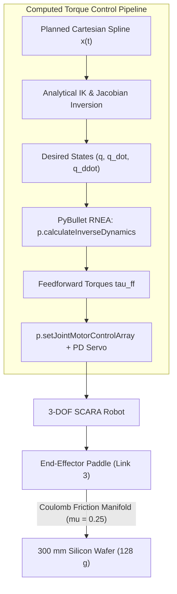

# High-Speed Non-Prehensile Wafer Handling Optimization
### Defense Notes & Technical Reference Manual

> [!IMPORTANT]
> **Project Thesis:** Autonomous high-speed transfer of an unclamped 300 mm silicon wafer between a FOUP cassette and a vacuum chamber via a narrow slit valve aperture ($350\text{ mm} \times 50\text{ mm}$) using a 3-DOF planar SCARA manipulator without exceeding Coulomb friction limits.
>
> - **Nominal Coefficient of Friction:** $\mu_s = 0.25$
> - **Engineering Derating Safety Factor:** $\eta = 0.85$
> - **Maximum Permissible Cartesian Acceleration:** $a_{\max} = \eta \mu_s g \approx 2.085\text{ m/s}^2$
> - **Allowable Relative Wafer Displacement Threshold:** $\Delta r_{\text{wafer}} \le 0.100\text{ mm}$ ($100\ \mu\text{m}$)

---

## Table of Contents
1. [System Architecture & Transfer Configuration](#1-system-architecture--transfer-configuration)
2. [Mathematical Foundations](#2-mathematical-foundations)
   - [2.1 Coulomb Friction Cone & Derated Boundary](#21-coulomb-friction-cone--derated-boundary)
   - [2.2 Forward & Inverse Kinematics with Yaw Decoupling](#22-forward--inverse-kinematics-with-yaw-decoupling)
   - [2.3 Differential & Acceleration Kinematics](#23-differential--acceleration-kinematics)
   - [2.4 Time-Optimal Path Parameterization (TOPP-RA)](#24-time-optimal-path-parameterization-topp-ra)
3. [Physics Engine Calibration Rationale (PyBullet)](#3-physics-engine-calibration-rationale-pybullet)
   - [3.1 Geometric Thickness Expansion (Tunneling Mitigation)](#31-geometric-thickness-expansion-tunneling-mitigation)
   - [3.2 Multiplicative Contact Friction Calibration](#32-multiplicative-contact-friction-calibration)
   - [3.3 Timestep Selection & Contact Cache Mechanics](#33-timestep-selection--contact-cache-mechanics)
4. [Experimental History & Benchmark Telemetry Log](#4-experimental-history--benchmark-telemetry-log)
   - [4.1 Progression Benchmark Table](#41-progression-benchmark-table)
   - [4.2 Root-Cause Failure Analyses (Runs 0–3)](#42-root-cause-failure-analyses-runs-03)
   - [4.3 Run 4: Computed Torque Control Formulation](#43-run-4-computed-torque-control-formulation)
5. [Oral Defense Technical Q&A](#5-oral-defense-technical-qa)

---

## 1. System Architecture & Transfer Configuration

- **Wafer Dimensions:** Diameter $300\text{ mm}$, mass $m_w = 0.128\text{ kg}$, calibrated simulation collision thickness $4.0\text{ mm}$.
- **Manipulator Kinematic Dimensions:** Shoulder link $l_1 = 0.40\text{ m}$, forearm link $l_2 = 0.35\text{ m}$, paddle wrist-to-COM $l_3 = 0.15\text{ m}$.
- **Slit Valve Enclosure:** Width $350\text{ mm}$, vertical clearance window $50\text{ mm}$ ($Z \in [0.065\text{ m}, 0.115\text{ m}]$).

---

## 2. Mathematical Foundations

### 2.1 Coulomb Friction Cone & Derated Boundary

In non-prehensile semiconductor handling, the wafer rests on the flat horizontal surface of the end-effector paddle without mechanical clamps or vacuum suction. Backside particle generation and wafer warpage are prevented by relying entirely on planar friction.

#### d'Alembert Dynamic Equilibrium
In an accelerating coordinate frame fixed to the paddle moving with planar acceleration $\mathbf{a}_{\text{tip}} = [a_x, a_y]^T \in \mathbb{R}^2$ ($a_z = 0$):

$$
\mathbf{F}_{\text{inertial}} = - m_w \mathbf{a}_{\text{tip}}
$$

The contact normal force under gravity $g = 9.81\text{ m/s}^2$ is:

$$
N = m_w g
$$

The tangential friction force $\mathbf{f}_t \in \mathbb{R}^2$ must counter the inertial force:

$$
\mathbf{f}_t = m_w \mathbf{a}_{\text{tip}}
$$

#### Coulomb No-Slip Criterion
Macroscopic sliding is prevented if the tangential contact force remains strictly within the Coulomb friction cone:

$$
\|\mathbf{f}_t\|_2 \le \mu_s N \iff m_w \|\mathbf{a}_{\text{tip}}\|_2 \le \mu_s m_w g \iff \|\mathbf{a}_{\text{tip}}\|_2 \le \mu_s g
$$

For nominal static friction coefficient $\mu_s = 0.25$:

$$
a_{\text{coulomb}} = \mu_s g = 0.25 \times 9.81\text{ m/s}^2 = 2.4525\text{ m/s}^2
$$

#### Safety Factor Derating ($\eta = 0.85$)
To account for structural compliance, motor torque ripple, aerodynamic drafting, and discrete solver penetration effects, an engineering safety factor $\eta = 0.85$ is applied:

$$
a_{\max} = \eta \mu_s g = 0.85 \times 0.25 \times 9.81\text{ m/s}^2 \approx 2.0846\text{ m/s}^2
$$

All planned trajectories must strictly guarantee:

$$
\|\mathbf{a}_{\text{tip}}(t)\|_2 = \sqrt{\ddot{x}(t)^2 + \ddot{y}(t)^2} \le a_{\max} \approx 2.085\text{ m/s}^2 \quad \forall t \in [0, T]
$$

---

### 2.2 Forward & Inverse Kinematics with Yaw Decoupling

The planar SCARA operates with joint angles $\mathbf{q} = [\theta_1, \theta_2, \theta_3]^T \in \mathbb{R}^3$. Let $\theta_{12} = \theta_1 + \theta_2$ and $\theta_{123} = \theta_1 + \theta_2 + \theta_3$.

#### Forward Kinematics (FK)
The operational pose of the wafer center $\mathbf{x} = [x, y, \phi]^T$ is:

$$
\begin{aligned}
x(\mathbf{q}) &= l_1 \cos\theta_1 + l_2 \cos\theta_{12} + l_3 \cos\theta_{123} \\
y(\mathbf{q}) &= l_1 \sin\theta_1 + l_2 \sin\theta_{12} + l_3 \sin\theta_{123} \\
\phi(\mathbf{q}) &= \theta_1 + \theta_2 + \theta_3 = \theta_{123}
\end{aligned}
$$

#### Wrist Yaw Decoupling ($\phi \equiv 0^\circ$)
Passing through the slit valve aperture without side collisions requires zero yaw relative to the chamber axis:

$$
\phi = \theta_1 + \theta_2 + \theta_3 = 0^\circ \implies \theta_3 = -(\theta_1 + \theta_2)
$$

With $\phi \equiv 0$, $\cos\theta_{123} = 1$ and $\sin\theta_{123} = 0$, simplifying the wafer position equations to:

$$
\begin{aligned}
x &= l_1 \cos\theta_1 + l_2 \cos\theta_{12} + l_3 \\
y &= l_1 \sin\theta_1 + l_2 \sin\theta_{12}
\end{aligned}
$$

#### Analytical Inverse Kinematics (IK)
For any desired Cartesian pose $\mathbf{x}_{\text{des}} = [x, y, \phi]^T$:

**Step 1: Wrist pivot position:**

$$
x_w = x - l_3 \cos\phi, \quad y_w = y - l_3 \sin\phi
$$

**Step 2: Radial reach squared:**

$$
r_w^2 = x_w^2 + y_w^2
$$

**Step 3: Elbow angle $\theta_2$ (Law of Cosines):**

$$
D = \frac{r_w^2 - l_1^2 - l_2^2}{2 l_1 l_2}, \quad \theta_2 = \text{atan2}\left(\sqrt{1 - D^2}, D\right) \quad (\text{elbow-up})
$$

**Step 4: Shoulder angle $\theta_1$:**

$$
\theta_1 = \text{atan2}(y_w, x_w) - \text{atan2}(l_2 \sin\theta_2, l_1 + l_2 \cos\theta_2)
$$

**Step 5: Decoupled wrist angle $\theta_3$:**

$$
\theta_3 = \phi - (\theta_1 + \theta_2)
$$

---

### 2.3 Differential & Acceleration Kinematics

#### Operational Space Jacobian $\mathbf{J}(\mathbf{q})$
Differentiating forward kinematics with respect to time yields $\dot{\mathbf{x}} = \mathbf{J}(\mathbf{q})\dot{\mathbf{q}}$:

$$
\mathbf{J}(\mathbf{q}) = \begin{bmatrix}
-l_1 \sin\theta_1 - l_2 \sin\theta_{12} - l_3 \sin\theta_{123} & -l_2 \sin\theta_{12} - l_3 \sin\theta_{123} & -l_3 \sin\theta_{123} \\
 l_1 \cos\theta_1 + l_2 \cos\theta_{12} + l_3 \cos\theta_{123} &  l_2 \cos\theta_{12} + l_3 \cos\theta_{123} &  l_3 \cos\theta_{123} \\
 1 & 1 & 1
\end{bmatrix}
$$

#### Tip Acceleration & The Physical Significance of $\dot{\mathbf{J}}\dot{\mathbf{q}}$
Differentiating velocity yields operational tip acceleration:

$$
\mathbf{a}_{\text{tip}} = \ddot{\mathbf{x}} = \mathbf{J}(\mathbf{q})\ddot{\mathbf{q}} + \dot{\mathbf{J}}(\mathbf{q}, \dot{\mathbf{q}})\dot{\mathbf{q}}
$$

With joint rates $\omega_1 = \dot{\theta}_1$, $\omega_{12} = \dot{\theta}_1 + \dot{\theta}_2$, and $\omega_{123} = \dot{\theta}_1 + \dot{\theta}_2 + \dot{\theta}_3$:

$$
\dot{\mathbf{J}}(\mathbf{q}, \dot{\mathbf{q}}) = \begin{bmatrix}
-l_1 \cos\theta_1 \omega_1 - l_2 \cos\theta_{12} \omega_{12} - l_3 \cos\theta_{123} \omega_{123} & -l_2 \cos\theta_{12} \omega_{12} - l_3 \cos\theta_{123} \omega_{123} & -l_3 \cos\theta_{123} \omega_{123} \\
-l_1 \sin\theta_1 \omega_1 - l_2 \sin\theta_{12} \omega_{12} - l_3 \sin\theta_{123} \omega_{123} & -l_2 \sin\theta_{12} \omega_{12} - l_3 \sin\theta_{123} \omega_{123} & -l_3 \sin\theta_{123} \omega_{123} \\
 0 & 0 & 0
\end{bmatrix}
$$

> [!NOTE]
> **Physical Interpretation:**
> The convective acceleration $\dot{\mathbf{J}}(\mathbf{q}, \dot{\mathbf{q}})\dot{\mathbf{q}}$ accounts for centripetal accelerations (proportional to $\omega_i^2$) and Coriolis cross-coupling terms (proportional to $2 \omega_i \omega_j$). Even when joint accelerations are identically zero ($\ddot{\mathbf{q}} = \mathbf{0}$), joint velocities produce significant Cartesian acceleration that breaches the friction cone if neglected.

---

### 2.4 Time-Optimal Path Parameterization (TOPP-RA)

Given a geometric spline path $\mathbf{p}(s)$ parameterized by normalized arc coordinate $s \in [0, 1]$:

#### Phase-Plane Variables
Following Pham & Pham (2018), define:

$$
w(s) = \dot{s}^2, \quad u(s) = \ddot{s} = \frac{1}{2}\frac{dw}{ds}
$$

Kinematic derivatives map linearly in $(w, u)$:

$$
\begin{aligned}
\dot{\mathbf{p}}(s) &= \mathbf{p}'(s) \sqrt{w(s)} \\
\ddot{\mathbf{p}}(s) &= \mathbf{p}''(s) w(s) + \mathbf{p}'(s) u(s)
\end{aligned}
$$

#### Convex Optimization & Reachability
By discretizing the path into $N$ grid points $\{s_0, \dots, s_N\}$, the non-convex time-optimal problem is mapped into sequential Linear Programs (LPs):

1. **Backward Pass:** Computes controllable upper velocity bounds $w_i \le w_{i,\max}$ to guarantee terminal feasibility.
2. **Forward Integration:** Maximizes path velocity $w_i$ subject to the convex linear inequality constraints:

$$
\max_{u_i, w_{i+1}} w_{i+1} \quad \text{subject to} \quad w_{i+1} = w_i + 2 u_i \Delta s_i, \quad (u_i, w_i) \in \mathcal{K}_i
$$

3. **Trajectory Duration Quadrature:**

$$
T = \int_0^1 \frac{1}{\sqrt{w(s)}} \, ds = \sum_{i=0}^{N-1} \frac{2 \Delta s_i}{\sqrt{w_i} + \sqrt{w_{i+1}}}
$$

---

## 3. Physics Engine Calibration Rationale (PyBullet)

Simulating contact mechanics of thin rigid bodies in discrete-time physics engines requires explicit compensation for numerical solver artifacts.

### 3.1 Geometric Thickness Expansion (Tunneling Mitigation)
A physical 300 mm silicon wafer is $775\ \mu\text{m}$ thick. In PyBullet:
- Discrete collision detection algorithms (GJK / EPA) with timestep $\Delta t = 4.167\text{ ms}$ can experience penetrations of $10 - 50\ \mu\text{m}$.
- When penetration exceeds half the body thickness, the contact normal vector flips sign ($\hat{\mathbf{n}} \to -\hat{\mathbf{n}}$), causing normal inversion and explosive body ejection.
- Expanding the collision cylinder thickness to $4.0\text{ mm}$ ($2.0\text{ mm}$ half-height) establishes a stable penetration margin while maintaining the true wafer mass ($0.128\text{ kg}$) and planar contact surface.

### 3.2 Multiplicative Contact Friction Calibration
PyBullet calculates contact friction multiplicatively:

$$
\mu_{\text{effective}} = \mu_{\text{paddle}} \times \mu_{\text{wafer}}
$$

To achieve the physical Coulomb threshold $\mu_{\text{effective}} = 0.25$:
- Paddle lateral friction: $\mu_{\text{paddle}} = 1.0$
- Wafer lateral friction: $\mu_{\text{wafer}} = 0.25$
- Effective interface friction: $\mu_{\text{effective}} = 1.0 \times 0.25 = 0.250$

Additionally, `enableConeFriction=1` is configured in `p.setPhysicsEngineParameter` to enforce true circular cone geometry rather than decoupled pyramid approximations. Restitution is set to $0.0$.

### 3.3 Timestep Selection & Contact Cache Mechanics
- **Frequency:** $240\text{ Hz}$ ($\Delta t = 1/240\text{ s} \approx 4.167\text{ ms}$).
- **Projected Gauss-Seidel Solver:** Configured with `numSolverIterations=150` to guarantee numerical convergence of constraint forces.
- **Warm-Start Settling:** A 120-step static settling phase is executed prior to motion onset, allowing the wafer normal force to settle to static equilibrium ($N = m_w g = 1.2557\text{ N}$) and clearing transient contact cache artifacts.

---

## 4. Experimental History & Benchmark Telemetry Log

### 4.1 Progression Benchmark Table

| Run | Setup & Planning Strategy | Control / Actuation Method | Trajectory Duration | Max Measured Slip | Result | Root Cause / Failure Mechanism |
| :--- | :--- | :--- | :--- | :--- | :--- | :--- |
| **Run 0** (Phase 1 Baseline) | 1D Cartesian clamped spline via TOPP-RA | Dynamic box anchor (`JOINT_FIXED`, `erp=0.9`) | 1.060 s | 0.048 mm | **PASS** | Validated PyBullet calibrations (240 Hz, `numSolverIterations=150`, `enableConeFriction=1`, $\mu = 0.25$). |
| **Run 1** (Phase 2 Heuristic) | Joint-space spline; decoupled limits $\ddot{q}_i \le a_{\max}/L_i$ | Multi-joint PD control (`kp=0.8`) | 1.011 s | 49.352 mm | **FAIL** | **Kinematic Coupling Fallacy:** Neglected $\mathbf{J}\ddot{\mathbf{q}}$ vector addition and centripetal term $\dot{\mathbf{J}}\dot{\mathbf{q}}$. Commanded tip acceleration peaked at $\sim 4.5\text{ m/s}^2$ (180% above limit). |
| **Run 2** (Phase 2 Derated) | Joint-space spline; 4x derated scalar joint limits | Multi-joint PD control (`forces=[500, 400, 200]`) | 2.096 s | 19.642 mm | **FAIL** | **Scalar Bound Inadequacy:** Doubled cycle time, but rotational swing and vector superposition still breached the friction cone. Proved scalar joint limits cannot bound 2-norm Cartesian vectors. |
| **Run 3** (Phase 2 Operational) | Cartesian spline under 2-norm bound mapped via IK | Operational feedforward velocity $\dot{\mathbf{q}} = \mathbf{J}^{-1}\dot{\mathbf{x}}$ with PD (`kp=0.3, kd=1.0`) | 1.114 s | 12.804 mm | **FAIL** | **Dynamic Tracking Ringing:** Trajectory was kinematically bounded ($a_{\text{planned}} \le 2.085\text{ m/s}^2$), but uncompensated link inertia caused phase lag and high-frequency PD torque chatter ($a_{\text{actual}} \sim 3.4 - 4.1\text{ m/s}^2$). |
| **Run 4** (Pending) | Operational Space TOPP-RA | Computed Torque Control: Inverse Dynamics Feedforward (`p.calculateInverseDynamics` RNEA) | *TBD* | Target $\le 0.100\text{ mm}$ | *Pending* | Resolves inertial phase lag and servo chatter by canceling nonlinear manipulator dynamics via feedforward. |

---

### 4.2 Root-Cause Failure Analyses (Runs 0–3)

#### Run 1 Failure: The Kinematic Coupling Fallacy
Decoupled joint limits assume independent, orthogonal motion. In multi-link revolute manipulators:

$$
\mathbf{a}_{\text{tip}} = \mathbf{J}\ddot{\mathbf{q}} + \dot{\mathbf{J}}\dot{\mathbf{q}}
$$

Simultaneous rotation of Shoulder and Elbow links causes constructive vector addition of linear tangential accelerations and inward centripetal acceleration $\omega_1^2 (l_1 + l_2 \cos\theta_2)$. The tip acceleration vector magnitude peaked at $4.5\text{ m/s}^2$ ($180\%$ above $\mu_s g$), resulting in gross wafer slippage of $49.352\text{ mm}$.

#### Run 2 Failure: Inadequacy of Scalar Derating
Artificially reducing scalar joint acceleration limits by $4\times$ doubled the trajectory duration to $2.096\text{ s}$ but did not modify the configuration-dependent geometry of vector superposition. During high-curvature arcs, vector summation still exceeded $a_{\max}$, causing $19.642\text{ mm}$ slip. This proved that fixed scalar joint bounds cannot guarantee a 2-norm Cartesian acceleration limit.

#### Run 3 Failure: Dynamic Tracking Ringing
Trajectory planning was strictly bounded in Cartesian space ($a_{\text{planned}} \le 2.085\text{ m/s}^2$). However, decentralized PD servos without dynamic feedforward cannot anticipate link inertia:

$$
\boldsymbol{\tau} = \mathbf{M}(\mathbf{q})\ddot{\mathbf{q}} + \mathbf{C}(\mathbf{q}, \dot{\mathbf{q}})\dot{\mathbf{q}}
$$

The arm lagged behind the commanded motion profile. When errors accumulated, restorative PD torques snapped the joints forward, exciting high-frequency oscillations where actual tip acceleration spiked to $3.4 - 4.1\text{ m/s}^2$, breaking Coulomb stiction ($12.804\text{ mm}$ slip).

---

### 4.3 Run 4: Computed Torque Control Formulation

To resolve dynamic ringing, the controller must eliminate inertial tracking lag.

#### Recursive Newton-Euler Feedforward (RNEA)
Using inverse dynamics, feedforward torques are computed directly along the trajectory:

$$
\boldsymbol{\tau}_{\text{ff}} = \mathbf{M}(\mathbf{q}_{\text{des}})\ddot{\mathbf{q}}_{\text{des}} + \mathbf{C}(\mathbf{q}_{\text{des}}, \dot{\mathbf{q}}_{\text{des}})\dot{\mathbf{q}}_{\text{des}}
$$

In PyBullet, $\boldsymbol{\tau}_{\text{ff}}$ is evaluated via `p.calculateInverseDynamics` using commanded joint states $[\mathbf{q}_{\text{des}}, \dot{\mathbf{q}}_{\text{des}}, \ddot{\mathbf{q}}_{\text{des}}]$, where:

$$
\ddot{\mathbf{q}}_{\text{des}} = \mathbf{J}(\mathbf{q}_{\text{des}})^{-1}\left(\ddot{\mathbf{x}}_{\text{des}} - \dot{\mathbf{J}}(\mathbf{q}_{\text{des}}, \dot{\mathbf{q}}_{\text{des}})\dot{\mathbf{q}}_{\text{des}}\right)
$$

This feedforward signal linearizes the multi-body dynamics, enabling position and velocity feedback to act as a disturbance regulator without fighting link inertia.

---

## 5. Oral Defense Technical Q&A

### Q1: Why is non-prehensile manipulation preferred over vacuum or mechanical clamping in semiconductor wafer transfer?
Mechanical edge-gripping causes localized wafer edge micro-chipping, lattice fractures, and particle shedding that contaminate the vacuum process chamber. Vacuum chucking requires umbilical routing, risks backside particle embedding, and introduces localized thermal and mechanical distortion that degrades photolithography focus depth. Non-prehensile planar transport eliminates these failure modes completely by operating strictly within the Coulomb friction cone.

---

### Q2: What is the physical role of the convective acceleration term $\dot{\mathbf{J}}\dot{\mathbf{q}}$?
The term $\dot{\mathbf{J}}\dot{\mathbf{q}}$ represents the rate of change of the Jacobian along the motion trajectory, capturing centripetal accelerations (proportional to squared joint rates $\omega_i^2$) and Coriolis coupling between moving links. In high-speed motions, ignoring $\dot{\mathbf{J}}\dot{\mathbf{q}}$ severely underestimates operational tip acceleration, causing immediate friction cone violation even when joint accelerations $\ddot{\mathbf{q}}$ are small:

$$
\mathbf{a}_{\text{tip}} = \mathbf{J}(\mathbf{q})\ddot{\mathbf{q}} + \dot{\mathbf{J}}(\mathbf{q}, \dot{\mathbf{q}})\dot{\mathbf{q}}
$$

---

### Q3: Why can scalar joint acceleration limits never optimally bound Cartesian tip acceleration?
The mapping between joint space and operational space is configuration-dependent:

$$
\mathbf{a}_{\text{tip}} = \mathbf{J}(\mathbf{q})\ddot{\mathbf{q}} + \dot{\mathbf{J}}(\mathbf{q}, \dot{\mathbf{q}})\dot{\mathbf{q}}
$$

A scalar limit box in joint space $\{\ddot{q}_i \in [-\ddot{q}_{i,\max}, \ddot{q}_{i,\max}]\}$ maps to an oblique, configuration-varying zonotope in Cartesian space. It is either overly conservative (drastically increasing cycle times) or permits dangerous diagonal combinations where constructive vector superposition breaches the spherical 2-norm friction boundary:

$$
\|\mathbf{a}_{\text{tip}}\|_2 \le a_{\max}
$$
