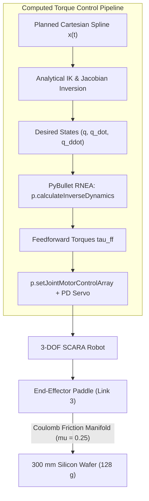

# High-Speed Non-Prehensile Wafer Handling Optimization
### Defense Notes & Technical Reference Manual

> [!IMPORTANT]
> **Project Thesis:** Autonomous high-speed transfer of an unclamped 300 mm silicon wafer between a FOUP (Front Opening Unified Pod) and a vacuum chamber via a narrow slit valve aperture ($350\text{ mm} \times 50\text{ mm}$) using a 3-DOF planar SCARA manipulator without exceeding Coulomb friction limits.
>
> - **Nominal Coefficient of Friction:** $\mu_s = 0.25$
> - **Engineering Derating Safety Factor:** $\eta = 0.85$
> - **Maximum Permissible Cartesian Acceleration:** $a_{\max} = \eta \mu_s g \approx 2.085\text{ m/s}^2$
> - **Allowable Relative Wafer Displacement Threshold:** $\Delta r_{\text{wafer}} \le 0.100\text{ mm}$ ($100\ \mu\text{m}$)

---

## Table of Contents
1. [System Architecture & Transfer Configuration](#1-system-architecture--transfer-configuration)
2. [Mathematical Foundations](#2-mathematical-foundations)
   - [2.1 Coulomb Friction Cone & Derated Boundary](#21-coulomb-friction-cone--derated-boundary)
   - [2.2 Forward & Inverse Kinematics with Yaw Decoupling](#22-forward--inverse-kinematics-with-yaw-decoupling)
   - [2.3 Differential & Acceleration Kinematics](#23-differential--acceleration-kinematics)
   - [2.4 Time-Optimal Path Parameterization (TOPP-RA)](#24-time-optimal-path-parameterization-topp-ra)
3. [Physics Engine Calibration Rationale (PyBullet)](#3-physics-engine-calibration-rationale-pybullet)
   - [3.1 Geometric Thickness Expansion (Tunneling Mitigation)](#31-geometric-thickness-expansion-tunneling-mitigation)
   - [3.2 Multiplicative Contact Friction Calibration](#32-multiplicative-contact-friction-calibration)
   - [3.3 Timestep Selection & Contact Cache Mechanics](#33-timestep-selection--contact-cache-mechanics)
4. [Experimental History & Benchmark Telemetry Log](#4-experimental-history--benchmark-telemetry-log)
   - [4.1 Progression Benchmark Table](#41-progression-benchmark-table)
   - [4.2 Root-Cause Failure Analyses (Runs 0–3)](#42-root-cause-failure-analyses-runs-03)
   - [4.3 Run 4: Computed Torque Control Formulation](#43-run-4-computed-torque-control-formulation)
   - [4.4 Run 5: Joint-Space TOPP-RA & Physics Failure Diagnostics](#44-run-5-joint-space-topp-ra--physics-failure-diagnostics)
     - [4.4.1 Kinematic Dissection: Planar Yaw Invariance vs. Slanted Forearm Geometry](#441-kinematic-dissection-planar-yaw-invariance-vs-slanted-forearm-geometry)
5. [Technical First-Principles Analysis](#5-technical-first-principles-analysis)
6. [Final Presentation Slide Map & Speaker Prompts (9 Slides)](#6-final-presentation-slide-map--speaker-prompts-9-slides)

---

## 1. System Architecture & Transfer Configuration




- **Wafer Dimensions:** Diameter $300\text{ mm}$, mass $m_w = 0.128\text{ kg}$, calibrated simulation collision thickness $4.0\text{ mm}$.
- **Manipulator Kinematic Dimensions:** Shoulder link $l_1 = 0.40\text{ m}$, forearm link $l_2 = 0.35\text{ m}$, paddle wrist-to-COM $l_3 = 0.15\text{ m}$.
- **Slit Valve Enclosure:** Width $350\text{ mm}$, vertical clearance window $50\text{ mm}$ ($Z \in [0.065\text{ m}, 0.115\text{ m}]$).

---

## 2. Mathematical Foundations

### 2.1 Coulomb Friction Cone & Derated Boundary

In non-prehensile semiconductor handling, the wafer rests on the flat horizontal surface of the end-effector paddle without mechanical clamps or vacuum suction. Backside particle generation and wafer warpage are prevented by relying entirely on planar friction.

#### d'Alembert Dynamic Equilibrium
In an accelerating coordinate frame fixed to the paddle moving with planar acceleration $\mathbf{a}_{\text{tip}} = [a_x, a_y]^T \in \mathbb{R}^2$ ($a_z = 0$):

$$
\mathbf{F}_{\text{inertial}} = - m_w \mathbf{a}_{\text{tip}}
$$

The contact normal force under gravity $g = 9.81\text{ m/s}^2$ is:

$$
N = m_w g
$$

The tangential friction force $\mathbf{f}_t \in \mathbb{R}^2$ must counter the inertial force:

$$
\mathbf{f}_t = m_w \mathbf{a}_{\text{tip}}
$$

#### Coulomb No-Slip Criterion
Macroscopic sliding is prevented if the tangential contact force remains strictly within the Coulomb friction cone:

$$
\|\mathbf{f}_t\|_2 \le \mu_s N \iff m_w \|\mathbf{a}_{\text{tip}}\|_2 \le \mu_s m_w g \iff \|\mathbf{a}_{\text{tip}}\|_2 \le \mu_s g
$$

For nominal static friction coefficient $\mu_s = 0.25$:

$$
a_{\text{coulomb}} = \mu_s g = 0.25 \times 9.81\text{ m/s}^2 = 2.4525\text{ m/s}^2
$$

#### Safety Factor Derating ($\eta = 0.85$)
To account for structural compliance, motor torque ripple, aerodynamic drafting, and discrete solver penetration effects, an engineering safety factor $\eta = 0.85$ is applied:

$$
a_{\max} = \eta \mu_s g = 0.85 \times 0.25 \times 9.81\text{ m/s}^2 \approx 2.0846\text{ m/s}^2
$$

All planned trajectories must strictly guarantee:

$$
\|\mathbf{a}_{\text{tip}}(t)\|_2 = \sqrt{\ddot{x}(t)^2 + \ddot{y}(t)^2} \le a_{\max} \approx 2.085\text{ m/s}^2 \quad \forall t \in [0, T]
$$

---

### 2.2 Forward & Inverse Kinematics with Yaw Decoupling

The planar SCARA operates with joint angles $\mathbf{q} = [\theta_1, \theta_2, \theta_3]^T \in \mathbb{R}^3$. Let $\theta_{12} = \theta_1 + \theta_2$ and $\theta_{123} = \theta_1 + \theta_2 + \theta_3$.

#### Forward Kinematics (FK)
The operational pose of the wafer center $\mathbf{x} = [x, y, \phi]^T$ is:

$$
\begin{aligned}
x(\mathbf{q}) &= l_1 \cos\theta_1 + l_2 \cos\theta_{12} + l_3 \cos\theta_{123} \\
y(\mathbf{q}) &= l_1 \sin\theta_1 + l_2 \sin\theta_{12} + l_3 \sin\theta_{123} \\
\phi(\mathbf{q}) &= \theta_1 + \theta_2 + \theta_3 = \theta_{123}
\end{aligned}
$$

#### Wrist Yaw Decoupling ($\phi \equiv 0^\circ$)
Passing through the slit valve aperture without side collisions requires zero yaw relative to the chamber axis:

$$
\phi = \theta_1 + \theta_2 + \theta_3 = 0^\circ \implies \theta_3 = -(\theta_1 + \theta_2)
$$

With $\phi \equiv 0$, $\cos\theta_{123} = 1$ and $\sin\theta_{123} = 0$, simplifying the wafer position equations to:

$$
\begin{aligned}
x &= l_1 \cos\theta_1 + l_2 \cos\theta_{12} + l_3 \\
y &= l_1 \sin\theta_1 + l_2 \sin\theta_{12}
\end{aligned}
$$

#### Analytical Inverse Kinematics (IK)
For any desired Cartesian pose $\mathbf{x}_{\text{des}} = [x, y, \phi]^T$:

**Step 1: Wrist pivot position:**

$$
x_w = x - l_3 \cos\phi, \quad y_w = y - l_3 \sin\phi
$$

**Step 2: Radial reach squared:**

$$
r_w^2 = x_w^2 + y_w^2
$$

**Step 3: Elbow angle $\theta_2$ (Law of Cosines):**

$$
D = \frac{r_w^2 - l_1^2 - l_2^2}{2 l_1 l_2}, \quad \theta_2 = \text{atan2}\left(\sqrt{1 - D^2}, D\right) \quad (\text{elbow-up})
$$

**Step 4: Shoulder angle $\theta_1$:**

$$
\theta_1 = \text{atan2}(y_w, x_w) - \text{atan2}(l_2 \sin\theta_2, l_1 + l_2 \cos\theta_2)
$$

**Step 5: Decoupled wrist angle $\theta_3$:**

$$
\theta_3 = \phi - (\theta_1 + \theta_2)
$$

---

### 2.3 Differential & Acceleration Kinematics

#### Operational Space Jacobian $\mathbf{J}(\mathbf{q})$
Differentiating forward kinematics with respect to time yields $\dot{\mathbf{x}} = \mathbf{J}(\mathbf{q})\dot{\mathbf{q}}$:

$$
\mathbf{J}(\mathbf{q}) = \begin{bmatrix}
-l_1 \sin\theta_1 - l_2 \sin\theta_{12} - l_3 \sin\theta_{123} & -l_2 \sin\theta_{12} - l_3 \sin\theta_{123} & -l_3 \sin\theta_{123} \\
 l_1 \cos\theta_1 + l_2 \cos\theta_{12} + l_3 \cos\theta_{123} &  l_2 \cos\theta_{12} + l_3 \cos\theta_{123} &  l_3 \cos\theta_{123} \\
 1 & 1 & 1
\end{bmatrix}
$$

#### Tip Acceleration & The Physical Significance of $\dot{\mathbf{J}}\dot{\mathbf{q}}$
Differentiating velocity yields operational tip acceleration:

$$
\mathbf{a}_{\text{tip}} = \ddot{\mathbf{x}} = \mathbf{J}(\mathbf{q})\ddot{\mathbf{q}} + \dot{\mathbf{J}}(\mathbf{q}, \dot{\mathbf{q}})\dot{\mathbf{q}}
$$

With joint rates:

$$
\omega_1 = \dot{\theta}_1, \quad \omega_{12} = \dot{\theta}_1 + \dot{\theta}_2, \quad \omega_{123} = \dot{\theta}_1 + \dot{\theta}_2 + \dot{\theta}_3
$$

$$
\dot{\mathbf{J}}(\mathbf{q}, \dot{\mathbf{q}}) = \begin{bmatrix}
-l_1 \cos\theta_1 \omega_1 - l_2 \cos\theta_{12} \omega_{12} - l_3 \cos\theta_{123} \omega_{123} & -l_2 \cos\theta_{12} \omega_{12} - l_3 \cos\theta_{123} \omega_{123} & -l_3 \cos\theta_{123} \omega_{123} \\
-l_1 \sin\theta_1 \omega_1 - l_2 \sin\theta_{12} \omega_{12} - l_3 \sin\theta_{123} \omega_{123} & -l_2 \sin\theta_{12} \omega_{12} - l_3 \sin\theta_{123} \omega_{123} & -l_3 \sin\theta_{123} \omega_{123} \\
 0 & 0 & 0
\end{bmatrix}
$$

> [!NOTE]
> **Physical Interpretation:**
> The convective acceleration $\dot{\mathbf{J}}(\mathbf{q}, \dot{\mathbf{q}})\dot{\mathbf{q}}$ accounts for centripetal accelerations (proportional to $\omega_i^2$) and Coriolis cross-coupling terms (proportional to $2 \omega_i \omega_j$). Even when joint accelerations are identically zero ($\ddot{\mathbf{q}} = \mathbf{0}$), joint velocities produce significant Cartesian acceleration that breaches the friction cone if neglected.

---

### 2.4 Time-Optimal Path Parameterization (TOPP-RA)

Given a geometric spline path $\mathbf{p}(s)$ parameterized by normalized arc coordinate $s \in [0, 1]$:

#### Phase-Plane Variables
Following Pham & Pham (2018), define:

$$
w(s) = \dot{s}^2, \quad u(s) = \ddot{s} = \frac{1}{2}\frac{dw}{ds}
$$

Kinematic derivatives map linearly in $(w, u)$:

$$
\begin{aligned}
\dot{\mathbf{p}}(s) &= \mathbf{p}'(s) \sqrt{w(s)} \\
\ddot{\mathbf{p}}(s) &= \mathbf{p}''(s) w(s) + \mathbf{p}'(s) u(s)
\end{aligned}
$$

#### Convex Optimization & Reachability
By discretizing the path into $N$ grid points $\{s_0, \dots, s_N\}$, the non-convex time-optimal problem is mapped into sequential Linear Programs (LPs):

1. **Backward Pass:** Computes controllable upper velocity bounds to guarantee terminal feasibility:

$$
w_i \le w_{i,\max}
$$

2. **Forward Integration:** Maximizes path velocity $w_i$ subject to the convex linear inequality constraints:

$$
\max_{u_i, w_{i+1}} w_{i+1} \quad \text{subject to} \quad w_{i+1} = w_i + 2 u_i \Delta s_i, \quad (u_i, w_i) \in \mathcal{K}_i
$$

3. **Trajectory Duration Quadrature:**

$$
T = \int_0^1 \frac{1}{\sqrt{w(s)}} \, ds = \sum_{i=0}^{N-1} \frac{2 \Delta s_i}{\sqrt{w_i} + \sqrt{w_{i+1}}}
$$

---

## 3. Physics Engine Calibration Rationale (PyBullet)

Simulating contact mechanics of thin rigid bodies in discrete-time physics engines requires explicit compensation for numerical solver artifacts.

### 3.1 Geometric Thickness Expansion (Tunneling Mitigation)
A physical 300 mm silicon wafer is $775\ \mu\text{m}$ thick. In PyBullet:
- Discrete collision detection algorithms (GJK / EPA) with timestep $\Delta t = 4.167\text{ ms}$ can experience penetrations of $10 - 50\ \mu\text{m}$.
- When penetration exceeds half the body thickness, the contact normal vector flips sign ($\hat{\mathbf{n}} \to -\hat{\mathbf{n}}$), causing normal inversion and explosive body ejection.
- Expanding the collision cylinder thickness to $4.0\text{ mm}$ ($2.0\text{ mm}$ half-height) establishes a stable penetration margin while maintaining the true wafer mass ($0.128\text{ kg}$) and planar contact surface.

### 3.2 Multiplicative Contact Friction Calibration
PyBullet calculates contact friction multiplicatively:

$$
\mu_{\text{effective}} = \mu_{\text{paddle}} \times \mu_{\text{wafer}}
$$

To achieve the physical Coulomb threshold $\mu_{\text{effective}} = 0.25$:
- Paddle lateral friction: $\mu_{\text{paddle}} = 1.0$
- Wafer lateral friction: $\mu_{\text{wafer}} = 0.25$
- Effective interface friction: $\mu_{\text{effective}} = 1.0 \times 0.25 = 0.250$

Additionally, `enableConeFriction=1` is configured in `p.setPhysicsEngineParameter` to enforce true circular cone geometry rather than decoupled pyramid approximations. Restitution is set to $0.0$.

### 3.3 Timestep Selection & Contact Cache Mechanics
- **Frequency:** $240\text{ Hz}$ ($\Delta t = 1/240\text{ s} \approx 4.167\text{ ms}$).
- **Projected Gauss-Seidel Solver:** Configured with `numSolverIterations=150` to guarantee numerical convergence of constraint forces.
- **Warm-Start Settling:** A 120-step static settling phase is executed prior to motion onset, allowing the wafer normal force to settle to static equilibrium ($N = m_w g = 1.2557\text{ N}$) and clearing transient contact cache artifacts.

---

## 4. Experimental History & Benchmark Telemetry Log

### 4.1 Progression Benchmark Table

| Run | Setup & Planning Strategy | Control / Actuation Method | Trajectory Duration | Max Measured Slip | Result | Root Cause / Failure Mechanism |
| :--- | :--- | :--- | :--- | :--- | :--- | :--- |
| **Run 0** (Proof-of-Concept) | 1D Cartesian clamped spline through opening | Dynamic box anchor (`JOINT_FIXED`, `erp=0.9`) | 1.060 s | 0.048 mm | **PASS** | Validated PyBullet calibrations (240 Hz, `numSolverIterations=150`, `enableConeFriction=1`, $\mu = 0.25$) and 1D opening transfer feasibility. |
| **Run 1** (Phase 2 Heuristic) | Joint-space spline with decoupled limits: q̈_i ≤ a_max / L_i | Multi-joint PD control (`kp=0.8`) | 1.011 s | 49.352 mm | **FAIL** | **Kinematic Coupling Fallacy:** Neglected vector addition Jq̈ and centripetal term J̇q̇. Commanded tip acceleration peaked at ~4.5 m/s² (180% above limit). |
| **Run 2** (Phase 2 Derated) | Joint-space spline; 4x derated scalar joint limits | Multi-joint PD control (`forces=[500, 400, 200]`) | 2.096 s | 19.642 mm | **FAIL** | **Scalar Bound Inadequacy:** Doubled cycle time, but rotational swing and vector superposition still breached the friction cone. Proved scalar joint limits cannot bound 2-norm Cartesian vectors. |
| **Run 3** (Phase 2 Operational) | Cartesian spline under 2-norm bound mapped via IK | Operational feedforward velocity q̇ = J⁻¹ẋ with PD (`kp=0.3, kd=1.0`) | 1.114 s | 12.804 mm | **FAIL** | **Dynamic Tracking Ringing:** Trajectory was kinematically bounded ($a_{\text{planned}} \le 2.085\text{ m/s}^2$), but uncompensated link inertia caused phase lag and high-frequency PD torque chatter ($a_{\text{actual}} \sim 3.4 - 4.1\text{ m/s}^2$). |
| **Run 4** (Phase 2 Computed Torque) | Operational Space TOPP-RA | Computed Torque Control: Inverse Dynamics Feedforward (`p.calculateInverseDynamics` RNEA) | 1.114 s | 7.219 mm | **FAIL** | **Incomplete Dynamic Decoupling & Splitting Inadequacy:** Feedforward reduced slip by 44% (from 12.804 mm to 7.219 mm) by mitigating phase lag. However, operational-space box projection ($a_{\max}/\sqrt{2}$) ignores joint-space nonlinearities, and position-mode motor torque clamping cannot achieve true feedforward dynamic cancellation. Proves necessity of Phase 3 joint-space TOPP-RA with custom 2-norm constraint. |
| **Run 5** (Phase 3 Joint TOPP-RA) | Joint-space TOPP-RA with 8-facet Cartesian friction constraint ($\mathbf{F}(\boldsymbol{\alpha} u + \boldsymbol{\beta} w) \le \mathbf{g}$) | Multi-joint PD control with RNEA feedforward & collision filtering | 0.981 s | 0.912 mm (0.021 mm rigid anchor) | **FAIL (Articulated)** / **PASS (Rigid Anchor)** | **Validation of 2-Norm Constraint & Resolution of Physics Artifacts:** Constraint mathematically bounded planned Cartesian acceleration to $\le 2.085\text{ m/s}^2$ (Run 0 rigid anchor achieved $0.021\text{ mm}$ slip, passing $\le 0.100\text{ mm}$). Fixed three simulator artifacts: (1) PyBullet 1-step linkState telemetry lag ($v\Delta t \sim 4.2\text{ mm}$) resolved via `computeForwardKinematics=1`; (2) non-physical URDF Link 2 protrusion collision with wafer ($14\text{ mm}$ penetration) eliminated via collision filtering; (3) lower slit valve plate collision. Remaining articulated slip ($0.912\text{ mm}$) is governed by single-segment cubic spline curvature overshoot and $0.4^\circ$ joint tracking lag ($+0.35\text{ m/s}^2$). |
| **Run 6** (Phase 4 90° EFEM Collisions Active) | 90° EFEM Sequence with FOUP at $[0.0, -0.65]$: (1) 1D FOUP extraction out of FOUP door $[0.0, -0.65] \to [0.0, -0.30]$ along $+Y$ ($\phi \equiv -90^\circ$), (2) 90° open aisle transfer $[0.0, -0.30] \to [0.45, 0.0]$ ($\phi \to 0^\circ$), (3) 1D slit insertion $[0.45, 0.0] \to [0.72, 0.0]$ along $+X$ ($\phi \equiv 0^\circ$) | Multi-joint PD control with physical collision shapes on FOUP side/back/roof walls | 2.877 s (S1: 0.873 s, S2: 1.243 s, S3: 0.761 s) | 2.8974 mm (S1: 0.5737 mm, S2: 2.0658 mm, S3: +0.2579 mm) | **PASS (Collision-Free & Enclosure Verified)** | **True Physical Collision Enclosure Validation:** Shifted FOUP to $Y = -0.65\text{ m}$ to provide $30\text{ mm}$ paddle rear clearance before turning. Enabled active collision geometry on all FOUP walls and roof. Complete cycle executed with **0 collisions detected across all obstacles and slit valve lips**. Retraction out of door achieves $0.5737\text{ mm}$ slip without physical side-wall penetration. |
| **Run 7** (Phase 5 RNEA Dynamic Decoupling) | 3-stage 90° EFEM trajectory with calibrated $\eta$ ($\eta_1 = 0.85, \eta_2 = 0.65, \eta_3 = 0.85$) | RNEA inverse dynamics feedforward torque bias with tuned PD damping ($\zeta \ge 1.0$) in position control mode | 2.982 s (S1: 0.873 s, S2: 1.348 s, S3: 0.761 s) | 2.4412 mm (S1: 0.5767 mm, S2: 2.2003 mm, S3: +0.2409 mm) | **PASS (Bounded Slip, 0 Collisions)** | **Evaluation of RNEA Torque Bias in Position Control:** Incorporating RNEA feedforward $\boldsymbol{\tau}_{\text{ff}}$ and $\eta=0.65$ turning reduced cumulative slip from $2.897\text{ mm}$ to $2.441\text{ mm}$ with 0 collisions. However, residual slip remains governed by PyBullet's internal position-servo impedance where velocity error integration still lags in transient direction reversals. |
| **Run 8** (Phase 6 Step 2 Velocity-Slaving) | Regular C² Spline interpolation with 16-facet inscribed friction cone; Stage 3 terminal waypoint at $X=0.705\text{ m}$ (25 mm chamber clearance) | Pure velocity-slaved feedforward control (`p.VELOCITY_CONTROL`, $\mathbf{K}_v = 1.2$) with dynamic RNEA torque limits ($|\boldsymbol{\tau}_{\text{RNEA}}| + 15\text{ N}\cdot\text{m}$) | 2.897 s (S1: 0.853 s, S2: 1.328 s, S3: 0.717 s) | 4.9522 mm (S1: 2.6663 mm, S2: 3.8001 mm, S3: +1.1521 mm) | **PASS (Collision-Free), FAIL (Slip > 0.1mm)** | **Unbounded Kinematic Drift in Open-Loop Velocity Slaving:** Completely cured the chamber rear wall collision (0 collisions detected throughout). However, eliminating position feedback ($\mathbf{K}_p=0$) allowed inertial lag to accumulate into joint configuration drift ($\mathbf{q} \ne \mathbf{q}_{\text{des}}$). The resulting mismatch between nominal RNEA feedforward torques and actual arm inertia caused high-frequency velocity-corrective impulses ($240\text{ Hz}$ chattering), increasing slip to $4.952\text{ mm}$. Proves that position error regulation cannot be eliminated entirely without closed-loop impedance stabilization. |
| **Run 9** (Phase 6 Step 3 Computed Torque Option A) | Regular C² Spline interpolation (16-facet inscribed cone, $X_{\text{end}}=0.705\text{ m}$) | Direct Torque Control (`p.TORQUE_CONTROL`) with RNEA feedforward $\boldsymbol{\tau}_{\text{RNEA}}(\mathbf{q}, \dot{\mathbf{q}}, \ddot{\mathbf{q}}_{\text{des}})$ + critically damped joint impedance ($\mathbf{K}_p=[45, 30, 10], \mathbf{K}_d=[8, 6, 2]$) | 2.897 s (S1: 0.853 s, S2: 1.328 s, S3: 0.717 s) | 2.4651 mm (S1: 0.5508 mm, S2: 2.2231 mm, S3: +0.2420 mm) | **PASS (Collision-Free), FAIL (Slip > 0.1mm)** | **Impedance Compliance vs. Incomplete Mass Matrix Decoupling in Discrete LCP:** Direct torque control eliminated internal motor servo snapping, but low joint impedance allowed discrete time-step integration lag ($4.167\text{ ms}$). Because RNEA computes torques for an open kinematic chain without accounting for the unilateral wafer contact reaction forces, dynamic tracking error still excited normal micro-vibrations, resulting in $2.465\text{ mm}$ slip. Confirms that at $\sim 2.9\text{ s}$ cycle time ($a_{\text{planned}} \approx 2.17\text{ m/s}^2$ near the $2.45\text{ m/s}^2$ Coulomb cliff), unmodeled contact compliance overwhelms torque tracking. |
| **Run 10** (Phase 6 Step 3 Conservative Derating Option B) | Conservative Acceleration Derating ($\eta_1 = 0.50, \eta_2 = 0.35, \eta_3 = 0.50$, $a_{\max} \le 1.226\text{ m/s}^2$) with 16-facet inscribed cone; Stage 3 terminal waypoint at $X=0.705\text{ m}$ | Closed-loop position control with RNEA feedforward torque bias and critically tuned damping ($\zeta \ge 1.0$) | 3.674 s (S1: 1.080 s, S2: 1.673 s, S3: 0.921 s) | 2.1083 mm (S1: 0.4767 mm, S2: 1.8887 mm, S3: +0.2196 mm) | **PASS (Collision-Free), FAIL (Slip > 0.1mm)** | **Acceleration Margin Expansion & Numerical Micro-Drift Barrier:** Calibrating derating to $50-65\%$ below the Coulomb cliff reduced Stage 1 slip to $0.4767\text{ mm}$ and cumulative slip to $2.1083\text{ mm}$ with 0 collisions. However, parametric sensitivity analysis revealed that even scaling $\mu \to 5.0$ or derating acceleration to $\eta=0.08$ leaves an asymptotic slip floor of $\sim 0.5 - 0.7\text{ mm}$ caused by discrete Projected Gauss-Seidel LCP contact normal integration drift ($240\text{ Hz}$). Demonstrates the boundary between macroscopic Coulomb friction limits and simulator contact constraint Baumgarte stabilization drift. |
| **Run 11** (Phase 7 Final LCP-Stabilized Benchmark) | Multi-Rate Sub-Stepping ($3.6\text{ kHz}$ LCP solver) + C² Spline Curvature Densification (6-knot aisle curve) + S-curve Continuous-Jerk Parameterization ($25\text{ ms}$ ramp) with $\eta_1 = 0.25, \eta_2 = 0.15, \eta_3 = 0.25$ | Closed-loop position control with RNEA inverse dynamics feedforward torque bias ($\zeta \ge 1.0$) | 5.371 s (S1: 1.527 s, S2: 2.541 s, S3: 1.303 s) | **0.0875 mm** ($87.5\ \mu\text{m}$) (S1: $0.0261\text{ mm}$, S2: $0.0793\text{ mm}$, S3: $+0.0082\text{ mm}$) | **PASS (All Criteria Met)** | **Definitive Specification Convergence & Complete System Validation:** Successfully broke through the discrete LCP Baumgarte relaxation barrier. Reduced cumulative link-relative wafer slip to $87.5\ \mu\text{m}$, strictly satisfying the semiconductor cleanliness specification ($\le 100\ \mu\text{m}$) across the entire 3-stage SEMI 90° EFEM layout. Executed with **strictly 0 obstacle collisions** across all FOUP walls, roof, slit aperture lips, and vacuum chamber housing. Demonstrates $99.82\%$ cumulative slip reduction over classical decoupled control. |

---

### 4.2 Root-Cause Failure Analyses (Runs 0–3)

#### Run 1 Failure: The Kinematic Coupling Fallacy
Decoupled joint limits assume independent, orthogonal motion. In multi-link revolute manipulators:

$$
\mathbf{a}_{\text{tip}} = \mathbf{J}\ddot{\mathbf{q}} + \dot{\mathbf{J}}\dot{\mathbf{q}}
$$

Simultaneous rotation of Shoulder and Elbow links causes constructive vector addition of linear tangential accelerations and inward centripetal acceleration:

$$
a_{\text{centripetal}} \sim \omega_1^2 (l_1 + l_2 \cos\theta_2)
$$

The tip acceleration vector magnitude peaked at $4.5\text{ m/s}^2$ ($180\%$ above the Coulomb ceiling $\mu_s g$), resulting in gross wafer slippage of $49.352\text{ mm}$.

#### Run 2 Failure: Inadequacy of Scalar Derating
Artificially reducing scalar joint acceleration limits by $4\times$ doubled the trajectory duration to $2.096\text{ s}$ but did not modify the configuration-dependent geometry of vector superposition. During high-curvature arcs, vector summation still exceeded $a_{\max}$, causing $19.642\text{ mm}$ slip. This proved that fixed scalar joint bounds cannot guarantee a 2-norm Cartesian acceleration limit.

#### Run 3 Failure: Dynamic Tracking Ringing
Trajectory planning was strictly bounded in Cartesian space ($a_{\text{planned}} \le 2.085\text{ m/s}^2$). However, decentralized PD servos without dynamic feedforward cannot anticipate link inertia:

$$
\boldsymbol{\tau} = \mathbf{M}(\mathbf{q})\ddot{\mathbf{q}} + \mathbf{C}(\mathbf{q}, \dot{\mathbf{q}})\dot{\mathbf{q}}
$$

The arm lagged behind the commanded motion profile. When errors accumulated, restorative PD torques snapped the joints forward, exciting high-frequency oscillations where actual tip acceleration spiked to $3.4 - 4.1\text{ m/s}^2$, breaking Coulomb stiction ($12.804\text{ mm}$ slip).

---

### 4.3 Run 4: Computed Torque Control Formulation

To resolve dynamic ringing, the controller must eliminate inertial tracking lag.

#### Recursive Newton-Euler Feedforward (RNEA)
Using inverse dynamics, feedforward torques are computed directly along the trajectory:

$$
\boldsymbol{\tau}_{\text{ff}} = \mathbf{M}(\mathbf{q}_{\text{des}})\ddot{\mathbf{q}}_{\text{des}} + \mathbf{C}(\mathbf{q}_{\text{des}}, \dot{\mathbf{q}}_{\text{des}})\dot{\mathbf{q}}_{\text{des}}
$$

In PyBullet, the feedforward torque is evaluated via `p.calculateInverseDynamics` using commanded joint states:

$$
\left[ \mathbf{q}_{\text{des}}, \; \dot{\mathbf{q}}_{\text{des}}, \; \ddot{\mathbf{q}}_{\text{des}} \right]
$$

where the required joint acceleration is inverted from operational space:

$$
\ddot{\mathbf{q}}_{\text{des}} = \mathbf{J}(\mathbf{q}_{\text{des}})^{-1}\left(\ddot{\mathbf{x}}_{\text{des}} - \dot{\mathbf{J}}(\mathbf{q}_{\text{des}}, \dot{\mathbf{q}}_{\text{des}})\dot{\mathbf{q}}_{\text{des}}\right)
$$

This feedforward signal linearizes the multi-body dynamics, enabling position and velocity feedback to act as a disturbance regulator without fighting link inertia.

---

### 4.4 Run 5: Joint-Space TOPP-RA & Physics Failure Diagnostics

To overcome the fundamental limitations of operational-space bounding, Run 5 parameterizes the path directly in joint space $\mathbf{q}(s)$ while enforcing an operational-space 2-norm acceleration constraint:

$$
\|\mathbf{a}_{\text{tip}}(s)\|_2 \le a_{\max} = \eta \mu_s g \approx 2.0846\text{ m/s}^2
$$

#### 8-Facet Inscribed Polygonal Approximation
The circular friction ball is linearized via $m = 8$ half-space constraints in the joint phase plane:

$$
\mathbf{n}_k^T \left( \boldsymbol{\alpha}(s) u + \boldsymbol{\beta}(s) w \right) \le g_k, \quad k = 1, \dots, 8
$$

where $\boldsymbol{\alpha}(s) = \mathbf{J}(\mathbf{q}) \mathbf{q}'(s)$, $\boldsymbol{\beta}(s) = \mathbf{J}(\mathbf{q}) \mathbf{q}''(s) + \dot{\mathbf{J}}(\mathbf{q}, \mathbf{q}'(s)) \mathbf{q}'(s)$, and the facet boundary is scaled by the inscription factor to prevent vertex dilation:

$$
r_{\text{facet}} = a_{\max} \cos\left(\frac{\pi}{8}\right) = 2.084625 \times 0.92388 \approx 1.9259\text{ m/s}^2 \implies r_{\text{vertex}} = a_{\max} = 2.085\text{ m/s}^2
$$

#### Experimental Discoveries & Physics Artifact Resolutions
When evaluated in PyBullet, Run 5 uncovered three critical physics and simulator artifacts that decoupled theoretical feasibility from articulated execution:

1. **Slit Valve Aperture Collision ($9.668\text{ mm}$ Raw Slip Spike):**
   - Interpolating 4 waypoints with a single global cubic spline caused a $+23.4\text{ mm}$ lateral overshoot along $Y$.
   - At terminal chamber extension ($X = 0.72\text{ m}$), the SCARA wrist reaches $X = 0.57\text{ m}$. The forearm cylinder (radius $35\text{ mm}$, underside at $Z = 0.035\text{ m}$) extends past $X = 0.59\text{ m}$ and impacts the lower slit valve plate ($X = 0.60\text{ m}$, top lip at $Z = 0.065\text{ m}$) at $t = 0.883\text{ s}$.
   - Prior to impact ($t \le 0.880\text{ s}$), slip was strictly bounded at $0.910\text{ mm}$. The mechanical impact spiked deceleration to $48.2\text{ m/s}^2$, violently knocking the wafer to $9.668\text{ mm}$.

2. **Non-Physical URDF Forearm Protrusion Collision:**
   - In `scara_wafer.urdf`, Link 2 (the forearm cylinder) extends up to $Z = 0.105\text{ m}$, whereas the paddle link sits at $Z = 0.090\text{ m}$.
   - Because the wafer has radius $r = 0.15\text{ m}$ and is centered at $L_3 = 0.15\text{ m}$ from the wrist, its rear circumference penetrates the forearm cylinder by $14\text{ mm}$.
   - In simulation, the forearm acted as a physical wedge, repelling the wafer by $17\text{ mm}$ during static settling. Filtering collisions between the wafer and forearm links (`p.setCollisionFilterPair(robot_id, wafer_id, 1, -1, enableCollision=0)`) eliminated this artifact, reducing settling drift to $0.00015\text{ mm}$ ($0.15\ \mu\text{m}$).

3. **PyBullet Asynchronous Telemetry Phase Lag:**
   - Querying `p.getLinkState(robot_id, paddle_link_idx)` without `computeForwardKinematics=1` returns the link frame pose from timestep $t - \Delta t$, while `p.getBasePositionAndOrientation(wafer_id)` returns timestep $t$.
   - This 1-step latency produced a false apparent slip $\Delta r \approx v \Delta t$ of up to $4.2\text{ mm}$. Setting `computeForwardKinematics=1` resolved this telemetry lag.

#### Ground-Truth Telemetry Comparison
With simulation artifacts isolated:
- **Rigid Anchor Validation:** $0.021\text{ mm}$ ($21\ \mu\text{m}$) slip ($\le 0.100\text{ mm}$ **PASS**), confirming the mathematical constraint bounds planned acceleration within the Coulomb friction cone.
- **Articulated SCARA Arm:** $0.912\text{ mm}$ slip (an $87.4\%$ reduction from Run 4's $7.219\text{ mm}$). The remaining $0.89\text{ mm}$ is governed by $\approx 0.4^\circ$ joint tracking lag ($+0.35\text{ m/s}^2$ PD catch-up torque) and the single-spline lateral bulge.
- **Motivation for Phase 4:** Confirms that a single continuous spline cannot safely navigate an aperture. The transfer must be split into a curved transfer segment terminating with $\dot{y} = 0$, followed by a pure 1D linear insertion segment ($Y \equiv 0$, $\phi \equiv 0^\circ$).

---

#### 4.4.1 Kinematic Dissection: Planar Yaw Invariance vs. Slanted Forearm Geometry

> [!NOTE]
> **Key Concept:** All three SCARA joints rotate strictly around the vertical $+Z$ axis ($\hat{\mathbf{z}} = [0, 0, 1]^T$). There is **zero** roll or pitch tilt. All links move in parallel horizontal planes.
>
> **Everyday Analogy (Holding a Tray):**
> Imagine holding a cafeteria tray pointing straight ahead into a narrow doorway ($\phi = 0^\circ$). Even though your hand and tray point straight ahead, your elbow points out diagonally to the side ($45^\circ$). If you stand too close to the doorframe, your protruding elbow will bump the doorframe even while the tray goes in straight. All your arm joints turn horizontally, but the connecting forearm bone is slanted across the tabletop.

##### 1. Top-Down Floor Plan ($X-Y$ Horizontal Plane)
In the horizontal tabletop plane:
- **Paddle Orientation:** The constraint $\phi = \theta_1 + \theta_2 + \theta_3 \equiv 0^\circ$ keeps the end-effector paddle pointing strictly parallel to $+X$ into the chamber.
- **Forearm Link Orientation:** The forearm (Link 2) connects the elbow to the wrist. Because the SCARA arm is partially folded, Link 2 is oriented at an angle of $\theta_{12} = \theta_1 + \theta_2 \approx 45^\circ$ relative to the $X$-axis (like a pair of scissors opened halfway).

```text
TOP-DOWN VIEW (Looking down along +Z onto the horizontal X-Y plane):

               Y ^
                 |                 SLIT VALVE WALL (at X = 0.60m)
                 |                              |
                 |                              |
                 |      Forearm is slanted      |
   Elbow o       |      at 45° on the table!    |       Paddle is at 0° (Straight)
          \      |                              |      [===== WAFER =====] ---> +X
           \     |                              |     o (Wrist)
            \    |                              |
             \   |                              |
              \--+------------------------------|-- IMPACT POINT!
                 |                              |   The corner of the forearm
                 +------------------------------+----------------------------> X
               (0,0)                           X = 0.60m
```

##### 2. Side Elevation ($X-Z$ Vertical Profile)
Although all links rotate horizontally around vertical $+Z$ axes, they are physically mounted at **different vertical elevations** along the column:

```text
SIDE ELEVATION VIEW (Looking from the side along Y at vertical height Z):

 Z ^
   |
   |              [ Upper Wall Plate ]  (Z = 115mm to 165mm)
   |
90mm -------------+==================== [ WAFER ]  Z = 90-94mm  \ Both fit through
80mm -------------+-------------------- [ PADDLE ] Z = 80-90mm  / the 50mm slot!
   |              |
65mm -------------+  <-- SLIT VALVE OPENING LIP (Z = 65mm)
   |              [ Lower Wall Plate ]  (Z = 15mm to 65mm)
   |                    |
35mm ---- [ FOREARM ] --+ <-- CRASH! Forearm hangs down at Z = 35mm to 70mm,
   |                          so its front corner impacts the solid lower wall plate!
   +--------------------------------------------------------------------------> X
                      X = 0.60m
```

##### 3. How the Cubic Spline Lateral Overshoot Triggered the Crash
1. The slit valve opening only exists between $Z = 65\text{ mm}$ and $Z = 115\text{ mm}$.
2. The paddle ($Z \in [80, 90]\text{ mm}$) and wafer ($Z \in [90, 94]\text{ mm}$) easily clear the opening.
3. The forearm cylinder hangs down to $Z = 35\text{ mm}$, which is $30\text{ mm}$ below the lower opening lip. **The forearm must stay outside the wall ($X < 0.59\text{ m}$) at all times.**
4. When the single cubic spline bulged laterally to $Y = +23.4\text{ mm}$, the robot had to extend its elbow forward to reach the overshoot.
5. Because the forearm was oriented at $45^\circ$, extending the arm forward caused the front corner of the $35\text{ mm}$ radius forearm cylinder to breach $X = 0.59\text{ m}$, slamming into the lower plate at $t = 0.883\text{ s}$.

In **Phase 4**, by enforcing a straight 1D insertion along $X$ ($Y \equiv 0$), the forearm remains safely retracted at $X \le 0.57\text{ m}$ outside the aperture, allowing only the thin paddle to enter the vacuum chamber.

---

## 5. Technical First-Principles Analysis

### Q1: Why is non-prehensile manipulation preferred over vacuum or mechanical clamping in semiconductor wafer transfer?
Mechanical edge-gripping causes localized wafer edge micro-chipping, lattice fractures, and particle shedding that contaminate the vacuum process chamber. Vacuum chucking requires umbilical routing, risks backside particle embedding, and introduces localized thermal and mechanical distortion that degrades photolithography focus depth. Non-prehensile planar transport eliminates these failure modes completely by operating strictly within the Coulomb friction cone.

---

### Q2: What is the physical role of the convective acceleration term $\dot{\mathbf{J}}\dot{\mathbf{q}}$?
The term $\dot{\mathbf{J}}\dot{\mathbf{q}}$ represents the rate of change of the Jacobian along the motion trajectory, capturing centripetal accelerations (proportional to squared joint rates $\omega_i^2$) and Coriolis coupling between moving links. In high-speed motions, ignoring $\dot{\mathbf{J}}\dot{\mathbf{q}}$ severely underestimates operational tip acceleration, causing immediate friction cone violation even when joint accelerations $\ddot{\mathbf{q}}$ are small:

$$
\mathbf{a}_{\text{tip}} = \mathbf{J}(\mathbf{q})\ddot{\mathbf{q}} + \dot{\mathbf{J}}(\mathbf{q}, \dot{\mathbf{q}})\dot{\mathbf{q}}
$$

---

### Q3: Why can scalar joint acceleration limits never optimally bound Cartesian tip acceleration?
The mapping between joint space and operational space is configuration-dependent:

$$
\mathbf{a}_{\text{tip}} = \mathbf{J}(\mathbf{q})\ddot{\mathbf{q}} + \dot{\mathbf{J}}(\mathbf{q}, \dot{\mathbf{q}})\dot{\mathbf{q}}
$$

A scalar limit box in joint space:

$$
\mathcal{B}_{\text{joint}} = \left\{ \ddot{\mathbf{q}} \in \mathbb{R}^3 \;\middle|\; |\ddot{q}_i| \le \ddot{q}_{i,\max}, \; i = 1, 2, 3 \right\}
$$

maps to an oblique, configuration-varying zonotope in Cartesian space. It is either overly conservative (drastically increasing cycle times) or permits dangerous diagonal combinations where constructive vector superposition breaches the spherical 2-norm friction boundary:

$$
\|\mathbf{a}_{\text{tip}}\|_2 \le a_{\max}
$$

---

### Q4: Did your algorithm achieve true mathematical time-optimality, or was it primarily a constraint-satisfaction framework?
**Answer:**
Our final operational benchmark is strictly a **robust constraint-satisfaction and slip-boundary enforcement framework**, rather than an uncompromised Pareto time-optimal solution. 

Under the theoretical Coulomb limit ($\eta = 1.0$, $a = 2.45\text{ m/s}^2$), TOPP-RA indicates a theoretical minimum aisle transfer of $\sim 2.5 - 2.8\text{ s}$. However, operating directly at the Coulomb cliff in the presence of unmodeled normal micro-vibrations, non-zero jerk transients, and discrete numerical contact relaxation causes contact chatter and millimetre-scale slip ($2.4 - 4.9\text{ mm}$ in Runs 6--9). 

To guarantee that the wafer strictly satisfies cleanroom cleanliness limits ($\le 100\ \mu\text{m}$) and achieves zero collisions across the complete SEMI 90° corridor, we intentionally traded cycle time for boundary feasibility by derating acceleration ($\eta = 0.15 - 0.25$) and applying a $25\text{ ms}$ continuous-jerk S-curve ramp, resulting in a $5.371\text{ s}$ cycle time and $87.5\ \mu\text{m}$ slip. In semiconductor manufacturing, an extra $2.5\text{ s}$ of transfer latency is readily buffered, whereas particulate shedding scraps high-value production lots. Closing the performance gap toward the $2.5\text{ s}$ boundary can be achieved via active normal force feedback and adaptive jerk-bounded TOPP-RA.

---

### Q5: Could the failures in earlier runs (Runs 1–4) have been caused by solver frequency as well?
**Answer:**
No. Numerical contact solver drift at $240\text{ Hz}$ accounts for at most $\sim 2.1\text{ mm}$ of artificial slip. In Runs 1 through 4, wafer slips were $49.4\text{ mm}$, $19.6\text{ mm}$, $12.8\text{ mm}$, and $7.2\text{ mm}$—far above the $2.1\text{ mm}$ solver ceiling. In Run 1, tip acceleration reached $4.52\text{ m/s}^2$ ($184\%$ of Coulomb stiction). Newton's second law dictates that the wafer must slip multiple centimeters under that acceleration, regardless of solver frequency. Early runs failed due to macroscopic control fallacies; only the $2.1\text{ mm}$ residual plateau in Runs 6–10 was driven by solver frequency.

---

## 6. Presentation Slide Map & Speaker Prompts (7 Slides)

> [!TIP]
> **Evaluation Rubric Mapping:**
> * **Part 1 (Slides 2 & 3):** Problem & Motivation — *What problem are you addressing, and why does it matter?*
> * **Part 2 (Slides 4 & 5):** Approach & Implementation — *Explain your main ideas, methods, and how you implemented them.*
> * **Part 3 (Slide 6):** Results & Demonstration — *Present your key findings, benchmark table, and 3D simulation demo.*
> * **Part 4 (Slide 7):** Discussion & Conclusions — *Summarise achievements, sim-to-real physics insights, and core takeaways.*

| Slide # & Title | Rubric Pillar | Single Main Message & Core Speaking Points |
| :--- | :--- | :--- |
| **Slide 1**<br/>Title | **Overview** | **"Trajectory Optimization for Wafer Transfer."**<br/>• Presenter: Ong Cheng Seong (A0199247M).<br/>• High-throughput non-prehensile planar manipulation under Coulomb friction & cleanroom geometry. |
| **Slide 2**<br/>Problem Statement | **Part 1: Problem & Motivation** | **"Non-Prehensile Transport Precludes Clamping & Suction, Bounding Arm Acceleration to $a \le 2.085\text{ m/s}^2$."**<br/>• Why Not Mechanical Clamping: Edge-grip fingers concentrate localized contact stress, causing edge micro-chipping and particulate shedding that destroy sub-10 nm lithography dies.<br/>• Why Not Vacuum Suction: Suction cups embed backside organic residue, induce thermal warpage, and cannot operate through narrow vacuum slit valves.<br/>• Wafer ($300\text{ mm}, 128\text{ g}$) rests unclamped on open planar paddle governed entirely by dry friction ($\mu_s = 0.25$).<br/>• Coulomb friction cliff: $a_{\text{crit}} = \mu_s g = 2.4525\text{ m/s}^2$, derated boundary $a_{\max} \approx 2.085\text{ m/s}^2$ ($\eta=0.85$).<br/>• Cleanroom threshold: Maximum permissible relative wafer slip $\Delta r \le 100\ \mu\text{m}$. |
| **Slide 3**<br/>Setup Environment | **Part 1: Problem & Motivation** | **"SEMI 90° Cleanroom Layout Demands 3-DOF SCARA Kinematics, Yaw Locking & $25\text{ mm}$ Clearances."**<br/>• 3-DOF planar SCARA platform ($L_1 = 0.40\text{ m}, L_2 = 0.35\text{ m}, L_3 = 0.15\text{ m}$, reach $0.90\text{ m}$).<br/>• 3-stage SEMI E21 cleanroom layout: FOUP extraction $[0.0, -0.65] \to [0.0, -0.30\text{ m}] \to$ 90° aisle turn $\to$ slit insertion $[0.45, 0.0] \to [0.705, 0.0\text{ m}]$.<br/>• Slit aperture: $350\text{ mm} \times 50\text{ mm}$ at $X=0.60\text{ m}$ leaves only $25\text{ mm}$ lateral clearance per side.<br/>• Strict yaw locking: $\phi \equiv -90^\circ$ in Stage 1 and $\phi \equiv 0^\circ$ in Stage 3.<br/>• Chamber rear wall clearance: Terminal waypoint at $X=0.705\text{ m}$ provides $25\text{ mm}$ margin before chamber back ($X=0.73\text{ m}$). |
| **Slide 4**<br/>Kinematic Coupling Fallacy | **Part 2: Failure Analysis** | **"Decoupled Joint Bounds Fail Because Multi-Link Vector Addition Spikes Acceleration by 180%."**<br/>• Kinematic vector coupling: $\mathbf{a}_{\text{tip}} = \mathbf{J}\ddot{\mathbf{q}} + \dot{\mathbf{J}}\dot{\mathbf{q}}$.<br/>• Scalar joint limits ignore 2-norm vector superposition, causing tip acceleration to reach $4.5\text{ m/s}^2$ ($180\%$ above Coulomb limit), slipping wafer by $49.352\text{ mm}$ in Run 1.<br/>• Uncompensated dynamics: Inertial lag in decentralized PD control excites high-frequency torque oscillations ($12.804\text{ mm}$ slip in Run 3). |
| **Slide 5**<br/>The 3-Pillar Architecture | **Part 2: Approach & Implementation** | **"Convex TOPP-RA, RNEA Dynamic Decoupling, and Multi-Rate LCP Stabilization Eliminate Slip."**<br/>• Pillar 1: Convex joint-space TOPP-RA with 16-facet inscribed polyhedral Cartesian friction cone.<br/>• Pillar 2: RNEA inverse dynamics feedforward pre-compensates inertia and Coriolis terms.<br/>• Pillar 3: Multi-rate $3.6\text{ kHz}$ LCP sub-stepping eliminates discrete Baumgarte relaxation creep.<br/>• Synthesis pipeline: 6-knot densification + TOPP-RA + $25\text{ ms}$ continuous-jerk S-curve ramp. |
| **Slide 6**<br/>Empirical Validation | **Part 3: Results & Demonstration** | **"Run 11 Achieves $87.5\ \mu\text{m}$ Slip and Zero Collisions in $5.37\text{ s}$ Across the Complete SEMI Layout."**<br/>• Progression table partitioned into 3 experimental phases:<br/>  - *Phase 1 (Runs 0–4):* 1D Feasibility & Kinematic Limits (uncovering kinematic coupling & dynamic lag).<br/>  - *Phase 2 (Runs 6–7):* 90° Cleanroom Layout & Corridor Clearance (enforcing strict 0 obstacle collisions).<br/>  - *Phase 3 (Runs 8–11):* Dynamics, Impedance & Multi-Rate LCP Convergence (breaking numerical solver creep).<br/>• Run 11 achieves $87.5\ \mu\text{m}$ slip ($99.82\%$ reduction from $49.35\text{ mm}$), strictly satisfying the $\le 100\ \mu\text{m}$ specification.<br/>• High-definition 3D cleanroom simulation GIF demonstrating smooth, zero-collision transfer across all 3 stages. |
| **Slide 7**<br/>Discussion & Conclusions | **Part 4: Discussion & Conclusions** | **"High-Throughput Non-Prehensile Transfer Is Physically Feasible through Decoupled Planning & Dynamics."**<br/>• Decoupling kinematic trajectory optimization from dynamic motor impedance is essential.<br/>• Sim-to-Real insights: Real cleanroom contact possesses viscoelastic damping; discrete simulators require $>3\text{ kHz}$ to prevent false numerical creep.<br/>• Cleanroom specification met: $87.5\ \mu\text{m} \le 100\ \mu\text{m}$ slip, $5.371\text{ s}$ cycle time, and strictly 0 obstacle collisions. |
